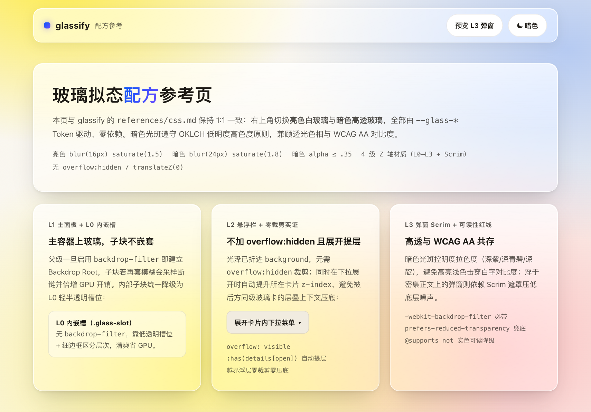
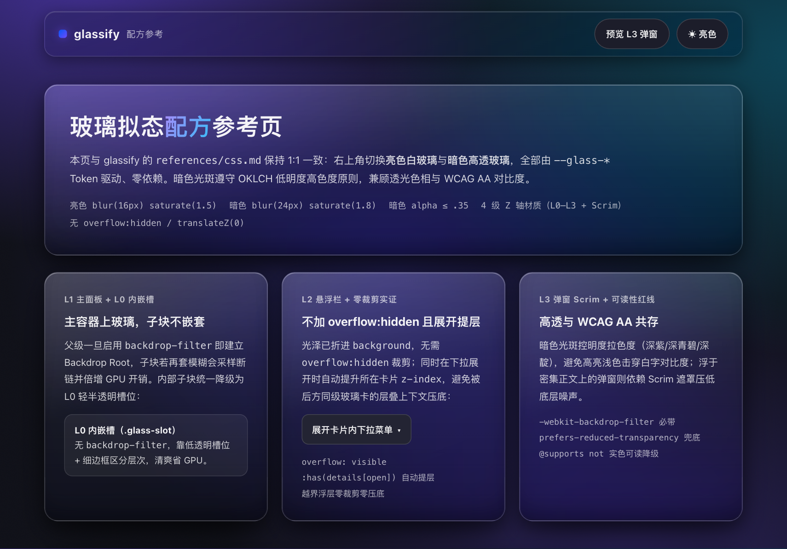

<!-- BADGE BAR -->
[](./LICENSE)
[](./SKILL.md)

# glassify

> **玻璃化改造师。** 将已有前端项目（CSS / Tailwind / Flutter / Token 组件库）改造为高完成度玻璃拟态（glassmorphism）风格——技术栈与不透明外壳审计，一次方案确认，Token 化按栈改造，机器 DOM 审计 + 多态视口截图验收。

| 亮色白玻璃 | 暗色高透玻璃 |
|:---:|:---:|
|  |  |

*↑ 配方活体参照页实拍，右上角一键切换主题——[在线交互预览](https://solplum.github.io/glassify/)*

## 触发

```
/glassify <项目路径> [颜色说明]
```

或对 agent 说：**玻璃化 / glassify / 上玻璃 / 毛玻璃 / 磨砂 / frosted glass / liquid glass**。适用于任何支持 `SKILL.md` 的 agent CLI / IDE（Claude Code / Codex / Antigravity / ZCode / Cursor 等）。

## 在线演示

**👉 [配方参考页（GitHub Pages 在线预览）](https://solplum.github.io/glassify/)** —— 右上角切换亮色白玻璃 / 暗色高透玻璃双主题，内含 4 级 Z 轴材质（L0 内嵌槽 / L1 主面板 / L2 顶栏 / L3 弹窗+Scrim）、暗色铁律 ✅/❌ 对照样品、无裁剪下拉实证与保持实色元素示例。源码在 [`docs/index.html`](./docs/index.html)，全部内联零依赖。

## 流程（一次确认，五步闭环）

1. **技术栈与结构审计** — 自动识别 Tailwind（v3/v4 + shadcn/ui）/ Flutter / CSS（含 Vue·Svelte·静态页·AntD/MUI），同时审计单双主题、阻挡光路的不透明外壳与 L0–L3 分层
2. **产出方案，一次确认** — 方案卡片整合色板选择（未指定颜色时附 4 套选项）、外壳剥离清单、分层改造计划与 `git status` / 非 Git 风险提示，确认前零写入
3. **Token 化按栈改造** — 按需加载 `references/{css,tailwind,flutter}.md`，先沉淀 `--glass-*` 变量与语义类（或 Flutter `GlassSurface`）再应用，剥离旧不透明 `bg-*`
4. **机器审计 + 多态视口截图验收** — 按 `references/verify.md` 跑确定性 DOM 审计脚本（验光路、禁嵌套、暗色 alpha 上限、零实色误伤、对比度）+ 三态视口截图（**禁 `fullPage: true`**，避免 `backdrop-filter` 拼接截断伪影）；无浏览器能力时降级静态自检并显式标注
5. **清单级可控回滚** — 按修改文件清单 + 新建文件清单精准恢复，避免漏删 untracked 新建文件或误伤无关改动

## 核心光学与工程铁律

- **光路必通**：先透明化 `body` / `#root` / 布局外壳的不透明底色，再铺光斑；Tailwind 存量改造必须移除旧不透明 `bg-*`
- **暗色高透 + OKLCH 色度控明**：L1 主面板 fill alpha `.12–.35`（L2 顶栏放宽至 `.30–.55`），`blur ≥ 24px` + `backdrop-saturate ≥ 1.6`（严禁误用前景 `saturate-*`）；暗色光斑选低明度高色度色相，兼顾艳丽透光与 WCAG AA 对比度
- **4 级 Z 轴材质阶梯（禁玻璃套玻璃）**：L0 内嵌子块禁 `backdrop-filter`（防 CSS Backdrop Root 断链），L3 弹窗必配 Scrim 遮罩，按钮 / 输入框 / 标签 / 表格行保持实色
- **零存量破坏**：禁止强加 `overflow: hidden`（防裁剪下拉菜单与 focus ring）和 `transform: translateZ(0)`（防覆盖弹窗居中与动效）
- **跨栈与无障碍兜底**：Web 必含 `-webkit-backdrop-filter`、`@supports not` 与 `@media (prefers-reduced-transparency: reduce)`；Flutter 外投影必设 `BlurStyle.outer`，长列表项禁 `BackdropFilter`

## 仓库结构

```
glassify/
├── SKILL.md                  # 主入口：触发边界、核心铁律与五阶段流程
├── references/
│   ├── css.md                # 手写 CSS / HTML / Vue·Svelte / Token 组件库配方
│   ├── tailwind.md           # Tailwind v3/v4（@utility / @layer）+ shadcn/ui 配方
│   ├── flutter.md            # Flutter GlassBackdrop + GlassSurface（BlurStyle.outer）配方
│   └── verify.md             # 确定性 DOM 审计脚本 + 三态视口截图验收手册
├── docs/index.html           # 零依赖活体配方参照页（GitHub Pages）
└── README.md
```

## 实战案例：exam-prep 刷题模板

exam-prep skill（备考刷题）的页面模板 quiz-template-v2 同样采用玻璃拟态：纽约日落摄影底 + 高透玻璃题卡（blur 12–24px，含 `-webkit-` 前缀），答题反馈的「逐步解析 / 知识点分支 / 解题模板」三层面板以玻璃分层呈现。下图为示例题库渲染实拍：


## 安装

整目录软链（symlink / junction）或复制进你的 agent skills 目录（确保 `SKILL.md` 与 `references/` 同在）：

```bash
git clone https://github.com/solplum/glassify.git
cp -r glassify <你的-agent>/skills/glassify
```

## License

MIT
